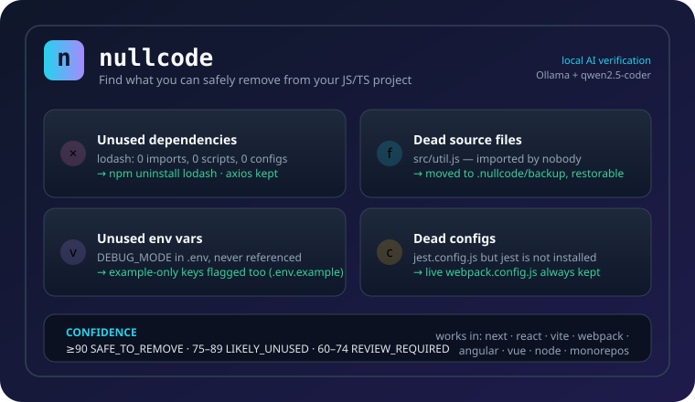

# nullcode

[](https://www.npmjs.com/package/nullcode)
[](https://www.npmjs.com/package/nullcode)
[](https://github.com/asirihewage/npm-nullcode/blob/main/LICENSE)

Finds code, dependencies, configuration files and environment variables in your
JavaScript/TypeScript project that appear **safe to remove** — with confidence
scores and an optional **local AI verification layer** powered by
[Ollama](https://ollama.com) (qwen2.5-coder or any coding model).

Everything runs locally: no source code or secrets ever leave your machine.



## Install

```bash
npm install -g nullcode
```

Requires Node.js >= 18.17.

## Local AI setup (recommended)

nullcode automatically uses your local Ollama install when it detects one:

```bash
# 1. install ollama (https://ollama.com/download)
# 2. pull a coding model
ollama pull qwen2.5-coder:7b     # small, fast (or qwen2.5-coder:14b for better results)
# 3. run nullcode — the local model verifies every candidate
nullcode
```

If Ollama is **not** installed, nullcode prints the setup instructions above and
falls back to deterministic scoring. No API keys, no cloud, no cost.

Alternative hosted providers (optional):

```bash
export DEEPSEEK_API_KEY=...     # or OPENAI_API_KEY
export NULLCODE_MODEL=qwen2.5-coder:7b   # override the model
export OLLAMA_URL=http://localhost:11434 # override the ollama endpoint
```

Disable AI with `nullcode --no-ai`.

## Usage

```bash
nullcode                     # full scan (default)
nullcode deps                # unused dependencies only
nullcode files               # dead files only
nullcode config              # unused config files only
nullcode env                 # unused environment variables only
nullcode src/auth.ts         # focus the report on one path
nullcode --explain lodash    # why was lodash flagged?
nullcode --json              # machine-readable output
nullcode --sarif             # SARIF 2.1 report
nullcode --ci                # exit 1 when safe-to-remove items exist (CI)
nullcode --fix --yes         # apply only ≥90% confidence removals
nullcode --interactive       # review every candidate before removal
nullcode init                # write a .nullcodeignore template
```

### Fixing

- `nullcode --fix --yes` removes dependencies (edits `package.json`), moves
  dead files into `.nullcode/backup/<timestamp>/`, and deletes unused configs —
  only for candidates at the ≥90% confidence bar (adjust with
  `--threshold <n>`).
- `nullcode --interactive` walks every candidate and lets you decide.
- Restore from a backup: `nullcode restore .nullcode/backup/<timestamp>`.

## What it detects

| Type | Example |
| --- | --- |
| Unused dependencies | `lodash` declared but never imported, required, scripted or configured |
| Dead source files | `src/legacy.ts` nobody imports, matches via globs, or references in strings |
| Dead stylesheets | `src/styles/old.css` not imported, globbed or referenced from HTML/Tailwind |
| Unused exports | `export function multiply()` never imported anywhere |
| Duplicate packages | same package in `dependencies` + `devDependencies`, or multiple lockfile versions |
| Unused configs | `babel.config.js` when the tool is not installed; legacy formats with modern siblings |
| Test utilities | `tests/helpers` never imported by any test |
| Unused env vars | `DEBUG_MODE` in `.env` never referenced anywhere |

## How it works

1. **Static analysis** — TS/Vue AST import graph, plus `require()`,
   `import()`, `import.meta.glob`, `require.context`, and re-exports.
2. **Jobs scanning** — bundler configs (Vite, Webpack, Rollup aliases),
   `tsconfig` paths, npm scripts, package.json `bin`/`exports`, Dockerfiles,
   CI workflows, config-file string references, and framework conventions
   (Next.js `app/`, Remix routes, Angular `main.ts`).
3. **Confidence scoring** — evidence-based, conservative; `≥90` is
   `SAFE_TO_REMOVE`, `75–89` `LIKELY_UNUSED`, `60–74` `REVIEW_REQUIRED`.
4. **AI verification** — every candidate's structured evidence is sent to your
   local coding model, which hunts for usage paths the static engine missed
   (dynamic keys, route maps, platform branches) and adjusts confidence.
5. **Backup-then-remove** — nothing is destroyed; state lives in
   `.nullcode/` and backups are restorable.

## Configuration

`.nullcodeignore` — gitignore-style patterns that are never scanned:

```
# .nullcodeignore
# generated/legacy dirs you already know about
src/legacy/**
vendor/**
```

## Development

```bash
npm install
npm run fixtures   # regenerate the test fixture projects
npm run typecheck
npm run lint
npm test
npm run build
npm publish        # publish the nullcode package
```

## License

MIT